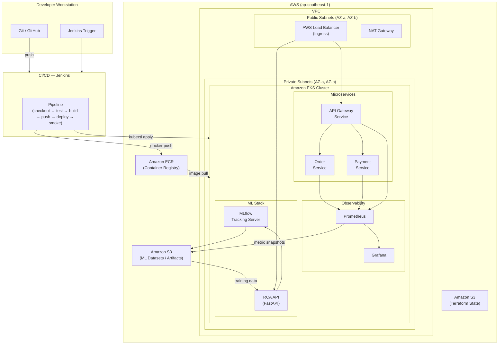

# AI-Powered Root Cause Analysis for Kubernetes Microservices

> **Status:** Repository skeleton and documentation only.  
> No application code, infrastructure, or ML models have been implemented yet.

---

## Table of Contents

1. [Overview](#overview)
2. [Problem Statement](#problem-statement)
3. [MVP Objectives](#mvp-objectives)
4. [Architecture](#architecture)
5. [Component Responsibilities](#component-responsibilities)
6. [Repository Structure](#repository-structure)
7. [Technology Stack](#technology-stack)
8. [Implementation Roadmap](#implementation-roadmap)
9. [Development Prerequisites](#development-prerequisites)
10. [AWS Cost Considerations](#aws-cost-considerations)
11. [Project Status](#project-status)

---

## Overview

This project builds a **Machine Learning system** that automatically identifies the likely root cause of incidents in a Kubernetes-based microservices application running on AWS EKS. It combines real-time observability (Prometheus and Grafana), controlled incident generation, supervised ML classification (scikit-learn / MLflow), and a REST prediction API (FastAPI) into an end-to-end MLOps pipeline driven by Jenkins.

The system is designed and implemented by a four-person university project team.

---

## Problem Statement

Operating a microservices application on Kubernetes introduces significant operational complexity. When an incident occurs—such as elevated error rates, increased latency, or unexpected resource consumption—identifying the root cause requires correlating metrics across many services, which is slow and error-prone when done manually.

This project addresses that problem by training a classifier on labeled observability metrics collected during controlled incidents. Once deployed, the system predicts the likely root-cause category for a given set of metrics, reducing mean time to diagnosis (MTTD).

---

## MVP Objectives

1. Deploy a minimal three-service microservices application (API Gateway, Order Service, Payment Service) on Amazon EKS.
2. Install Prometheus and Grafana to collect and visualise service metrics.
3. Run a set of controlled incidents and collect labeled metric snapshots.
4. Train a Random Forest classifier to distinguish between incident root-cause categories.
5. Track experiments and model artifacts with MLflow.
6. Expose predictions through a FastAPI endpoint (`POST /predict`).
7. Automate the build, test, and deployment pipeline with Jenkins.

The MVP does **not** include: distributed tracing, log aggregation (Loki), chaos engineering frameworks, auto-remediation, or production-grade multi-environment Terraform.

---

## Architecture

The diagram below describes the **intended** architecture. Components shown are planned for implementation; none are currently running.



---

## Component Responsibilities

| Directory | Technology | Responsibility |
|-----------|-----------|----------------|
| `services/` | Python / Docker | Microservice source code (API Gateway, Order Service, Payment Service) |
| `terraform/` | Terraform / AWS | Infrastructure as Code: VPC, EKS, ECR, IAM, S3 |
| `kubernetes/` | Kubernetes YAML | Application manifests: Deployments, Services, Ingress, ConfigMaps |
| `monitoring/` | Prometheus, Grafana, Helm | Metrics collection and visualisation |
| `ml/` | Python, scikit-learn, MLflow | Dataset preparation, model training, evaluation, experiment tracking |
| `rca-api/` | FastAPI, Docker | REST API serving RCA predictions |
| `jenkins/` | Jenkins | CI/CD pipeline automation |
| `scripts/` | Bash / Python | Operational scripts: incident generation, metric collection, health checks |
| `docs/` | Markdown | Architecture documentation, dataset schema, evaluation results |

---

## Repository Structure

```
ai-root-cause-analysis/
├── README.md                   ← This file
├── .gitignore
├── .dockerignore
├── .env.example
├── services/
│   └── README.md               ← Microservice source code (not yet implemented)
├── terraform/
│   └── README.md               ← AWS infrastructure and remote-state documentation
├── kubernetes/
│   └── README.md               ← Kubernetes manifests (not yet implemented)
├── monitoring/
│   └── README.md               ← Prometheus and Grafana setup documentation
├── ml/
│   └── README.md               ← ML pipeline documentation
├── rca-api/
│   └── README.md               ← FastAPI RCA prediction service documentation
├── jenkins/
│   └── README.md               ← CI/CD pipeline documentation
├── scripts/
│   └── README.md               ← Operational and experiment scripts documentation
└── docs/
    └── README.md               ← Architecture and methodology documentation
```

Future subdirectories will be added incrementally as implementation files are needed. Planned subdirectories that do not yet have content are documented in each directory's `README.md` rather than created as empty stubs.

---

## Technology Stack

| Category | Technology | Version target |
|----------|-----------|----------------|
| Cloud | AWS (VPC, EKS, ECR, IAM, S3) | Current |
| Infrastructure as Code | Terraform | ≥ 1.10 (for S3 native locking) |
| Container runtime | Docker | Current stable |
| Orchestration | Kubernetes | ≥ 1.29 (EKS managed) |
| Observability | Prometheus, Grafana | Helm kube-prometheus-stack |
| ML framework | scikit-learn | ≥ 1.4 |
| Experiment tracking | MLflow | ≥ 2.x |
| Prediction API | FastAPI | ≥ 0.111 |
| CI/CD | Jenkins | LTS |
| Language | Python | ≥ 3.11 |
| Version control | Git, GitHub | — |

---

## Implementation Roadmap

### Phase 1 — Repository Initialisation ✅ *(current phase)*
- Create the project skeleton, directory structure, and README files.
- Establish `.gitignore`, `.dockerignore`, and `.env.example`.
- Document the S3 remote-state design and Terraform workflow.

### Phase 2 — Bootstrap Terraform Remote State
- Create the S3 state bucket manually (or with a dedicated bootstrap script) in `ap-southeast-1`.
- Enable Block Public Access, versioning, and SSE-S3 encryption on the bucket.
- Run `terraform init` in `terraform/` to migrate local state to S3.
- Commit `.terraform.lock.hcl` after initialization.

### Phase 3 — Provision AWS Infrastructure
- Author Terraform configuration for VPC, subnets, Internet Gateway, NAT Gateway, EKS cluster, managed node group, IAM roles, and ECR repositories.
- Run `terraform plan` and review; run `terraform apply` after team sign-off.

### Phase 4 — Build and Push Container Images
- Write Dockerfiles for each microservice and the RCA API.
- Configure Jenkins to build images and push them to ECR.

### Phase 5 — Deploy Microservices to EKS
- Author Kubernetes manifests for all services.
- Apply manifests and verify Pod health, readiness, and Service connectivity.

### Phase 6 — Install Prometheus and Grafana
- Deploy `kube-prometheus-stack` via Helm.
- Configure scrape targets and verify metrics are collected.
- Import or build Grafana dashboards for key service metrics.

### Phase 7 — Incident Generation and Metric Collection
- Write scripts to inject controlled incidents (CPU stress, payment failure, database slowness).
- Collect labeled metric snapshots and store them in S3.

### Phase 8 — Train and Evaluate the ML Model
- Prepare the dataset and engineer features from raw metrics.
- Train a threshold-based baseline and a Random Forest classifier.
- Evaluate with Precision, Recall, Macro-F1, and a confusion matrix.

### Phase 9 — Track Experiments with MLflow
- Log parameters, metrics, and model artifacts to MLflow for each run.
- Register the best model in the MLflow Model Registry.

### Phase 10 — Deploy the RCA API
- Implement the FastAPI service with `GET /health` and `POST /predict`.
- Package as a Docker image, push to ECR, and deploy to EKS.
- Load the registered MLflow model artifact at startup.

### Phase 11 — Integrate Jenkins CI/CD
- Write a `Jenkinsfile` for each service covering: checkout → test → build → push → deploy → smoke test.
- Store all credentials in Jenkins Credentials; do not hardcode them.

### Phase 12 — End-to-End Evaluation
- Run a full incident scenario and verify that the RCA API returns the correct root-cause class.
- Document results, latency, and model accuracy in `docs/`.

---

## Development Prerequisites

The following tools must be installed on each developer's machine before starting work:

| Tool | Minimum version | Installation reference |
|------|----------------|----------------------|
| AWS CLI | v2 | https://docs.aws.amazon.com/cli/latest/userguide/install-cliv2.html |
| Terraform | ≥ 1.10 | https://developer.hashicorp.com/terraform/install |
| kubectl | Matches EKS version | https://kubernetes.io/docs/tasks/tools/ |
| Helm | ≥ 3.14 | https://helm.sh/docs/intro/install/ |
| Docker Desktop | Current stable | https://www.docker.com/products/docker-desktop |
| Python | ≥ 3.11 | https://www.python.org/downloads/ |
| Git | ≥ 2.40 | https://git-scm.com/downloads |

Authenticate the AWS CLI with an IAM identity that has appropriate permissions before running any Terraform or `kubectl` commands:

```bash
aws configure          # or set AWS_PROFILE / AWS_DEFAULT_REGION
aws sts get-caller-identity   # verify your identity
```

---

## AWS Cost Considerations

Running the MVP incurs AWS charges. The main cost drivers are:

| Resource | Approximate cost indicator |
|----------|--------------------------|
| EKS cluster control plane | ~USD 0.10/hour |
| EC2 node group (e.g., 2× t3.medium) | ~USD 0.04–0.09/hour per node |
| NAT Gateway | ~USD 0.045/hour + data transfer |
| Application Load Balancer | ~USD 0.008/hour + LCU charges |
| ECR storage | Low for MVP image sizes |
| S3 (state, datasets) | Negligible for MVP data volumes |

**Cost control actions:**
- Destroy the EKS cluster and node group when not actively working (`terraform destroy`).
- Do **not** destroy the S3 state bucket with the main infrastructure unless you are retiring the project entirely.
- Set up an AWS Budget alert at a comfortable threshold before applying infrastructure.
- Use `t3.medium` or smaller instance types for the node group during development.

---

## Project Status

| Component | Status |
|-----------|--------|
| Repository skeleton and documentation | ✅ Complete |
| S3 remote-state design | ✅ Documented |
| AWS infrastructure (Terraform) | ⏳ Not started |
| Microservice source code | ⏳ Not started |
| Kubernetes manifests | ⏳ Not started |
| Prometheus / Grafana setup | ⏳ Not started |
| Incident generation scripts | ⏳ Not started |
| ML training pipeline | ⏳ Not started |
| MLflow integration | ⏳ Not started |
| RCA API | ⏳ Not started |
| Jenkins CI/CD | ⏳ Not started |

---

*Project team: four-person university group. Questions or contributions: open a GitHub issue or pull request.*
